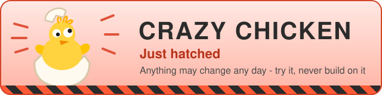

# porelo-buildtools



> **Crazy chicken - just hatched.** Interfaces, formats and even the purpose may change any day. Use it only to try ideas, never to build on.

The build and test tooling shared by the Porelo repositories, published to Maven Central under
`org.fuin.porelo`.

**Documentation: [porelo-ai.github.io/buildtools](https://porelo-ai.github.io/buildtools/)**, one chapter of
[all of Porelo's documentation](https://porelo-ai.github.io).

| Artifact | Directory | What it does |
|---|---|---|
| `porelo-machines` | [`machines/`](machines/README.md) | Rents test machines, builds the snapshots they boot from, runs the acceptance legs on them, and installs the pinned GraalVM in CI. |
| `porelo-release` | [`release/`](release/README.md) | Decides what an agent package may publish without a person, moves named pins, and checks that every workflow step is pinned by commit. |
| `porelo-stories` | [`stories/`](stories/README.md) | Checks story heads and issue indexes and generates stories and their index without a network connection. |
| `porelo-json` | [`json/`](json/README.md) | The JSON reader and writer `porelo-release` and `porelo-machines` share, and `porelo`'s `dist/package-check` reads. |
| `porelo-pinned-rule` | [`pinned-rule/`](pinned-rule/README.md) | The one rule by which a pinned download or an upload is tried again. |

## Building

```
JAVA_HOME=<the pinned GraalVM> ./mvnw -B clean verify
```

JDK 25; the pinned GraalVM is the one CI uses. The tools depend on nothing of porelo's; `porelo-json` is
their own JSON reader, and `porelo-pinned-rule` their one rule for asking again. See [AGENTS.md](AGENTS.md) for the conventions.

[Contributing](CONTRIBUTING.md), and [reporting a vulnerability](SECURITY.md).

## License

GPL-3.0-or-later, see [LICENSE](LICENSE); `porelo-stories` alone is LGPL-3.0-or-later, see [its license](stories/LICENSE).
